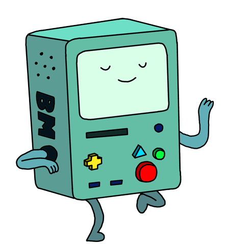

#  </p>

<p>


</p>

```diff
- 🎓 B.Eng. in Software Engineering (2025)
+ 💻 Front-end Engineer at Tencent (now)

- 🍄 Use code to make a difference in the world
+ 🌴 Build open-source projects to explore creative ideas
```
